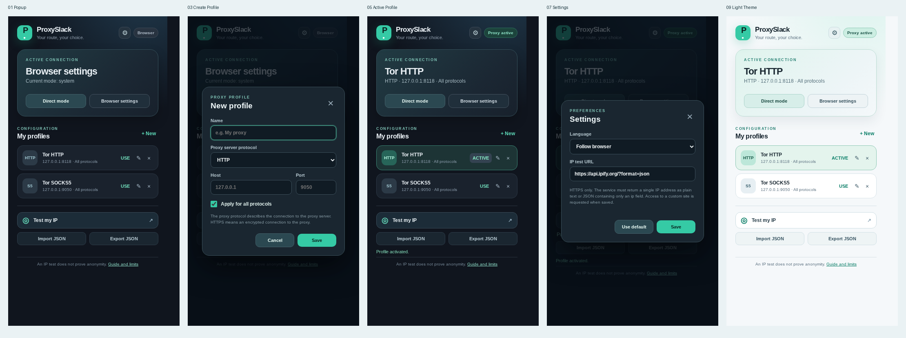
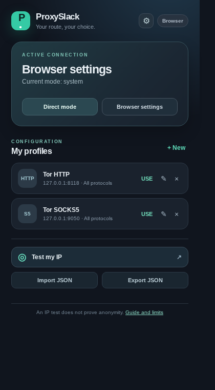
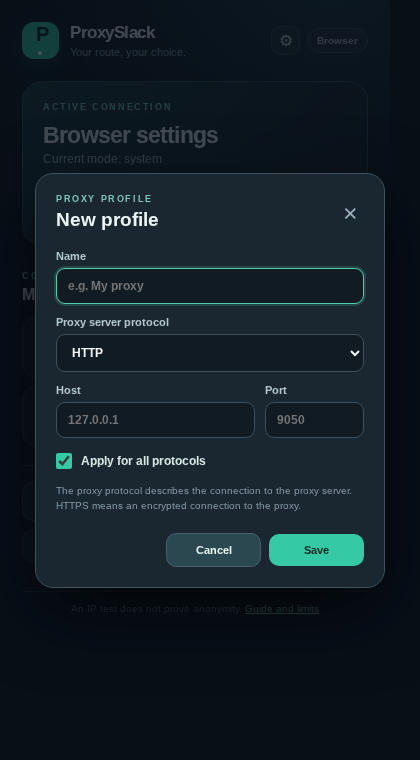
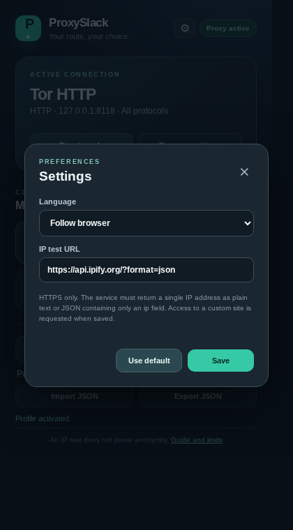
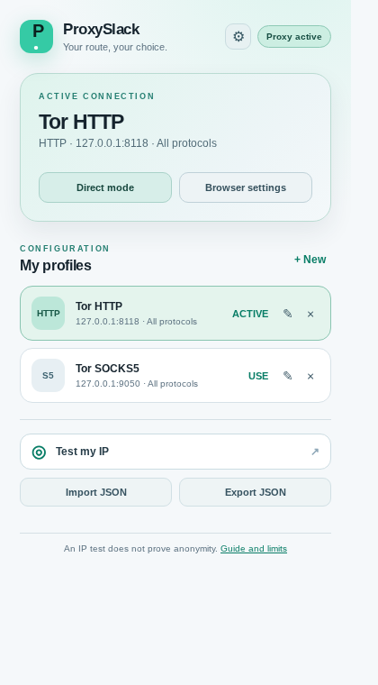

# ProxySlack

**Gestionnaire de profils proxy léger et libre pour les navigateurs basés sur Chromium.**

 



[English](README.md) · [Installation](docs/INSTALL.fr.md) · [Confidentialité](docs/PRIVACY.md) · [Sécurité](docs/SECURITY.md)

ProxySlack permet de choisir un profil HTTP, HTTPS, SOCKS4 ou SOCKS5, le mode direct ou les paramètres du navigateur. Par défaut, un profil s’applique à tous les protocoles de destination. L’interface est en français ou anglais, avec import/export JSON local, test IP à la demande et thèmes clair/sombre. Les profils initiaux sont Tor HTTP (`127.0.0.1:8118`) et Tor SOCKS5 (`127.0.0.1:9050`) ; il faut lancer soi-même le service proxy correspondant.

## Captures

| Fenêtre | Nouveau profil | Paramètres | Thème clair |
|---|---|---|---|
|  |  |  |  |

Les captures proviennent de l’extension exécutée dans Chromium. Le test IP emploie la réponse fictive réservée à la documentation `203.0.113.10`.

## Installation et mises à jour

Après compilation du CRX signé : `./install.sh --browser chromium --local`. Après publication d’une GitHub Release : `./install.sh --browser chromium`. `./update.sh --browser chromium` lance une mise à jour manuelle ; `./uninstall.sh --browser chromium` retire l’enregistrement externe. L’installation sans mode développeur dépend des règles du navigateur. Les mises à jour automatiques depuis GitHub Releases restent à vérifier. [Guide détaillé](docs/INSTALL.fr.md).

Brave et Vivaldi sont détectés, mais leurs chemins d’installation externe ne sont pas encore validés ; le script s’arrête sans modification. Les profils restent dans le stockage local du navigateur pendant les mises à jour.

## Compilation

Bash, Python 3 et OpenSSL sont nécessaires. Aucune dépendance JavaScript externe n’est chargée par l’extension.

```bash
./scripts/package.sh
PROXYSLACK_KEY_PATH=/chemin/prive/proxyslack.pem ./scripts/sign.sh --init-key # une seule fois
PROXYSLACK_KEY_PATH=/chemin/prive/proxyslack.pem ./scripts/sign.sh
./scripts/release.sh
node --test tests/*.test.js
```

Conserver et sauvegarder la clé privée hors du dépôt. Une nouvelle clé changerait l’identifiant de l’extension. [Confidentialité](docs/PRIVACY.md) · [Contributions](CONTRIBUTING.md) · [Licence MIT](LICENSE).

ProxySlack ne garantit pas l’anonymat et ne remplace pas Tor Browser ou un VPN. Le DNS, WebRTC, l’empreinte du navigateur et les autres applications exigent une attention distincte.

[Rapport de tests local](TEST_REPORT.md).
