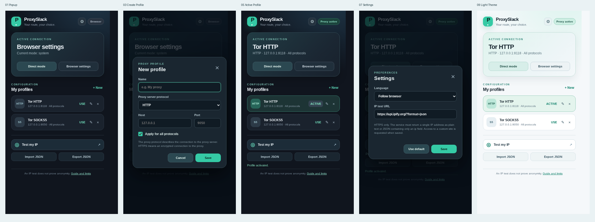
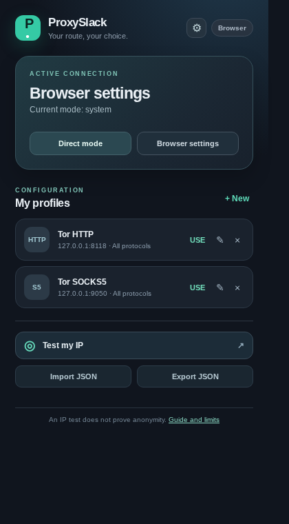
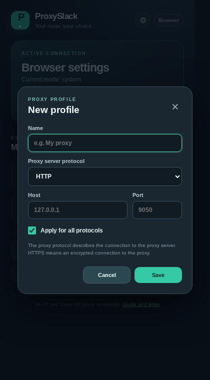
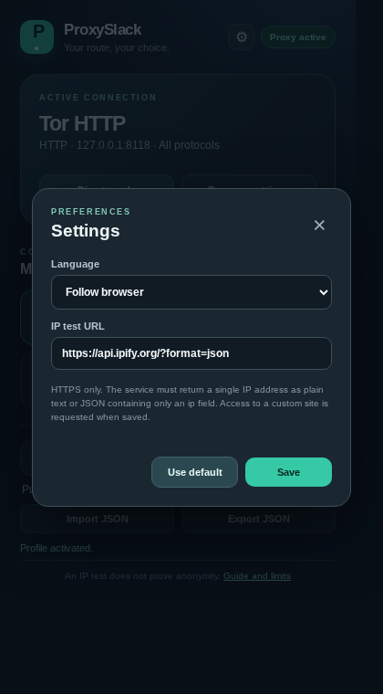
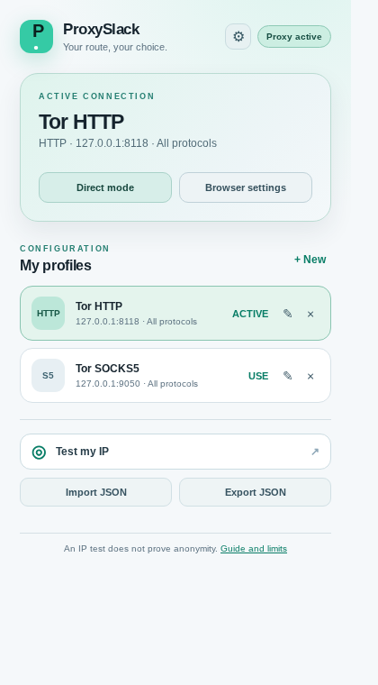

# ProxySlack

**Lightweight, open-source proxy profile manager for Chromium-based browsers.**

  



[Français](README.fr.md) · [Install](docs/INSTALL.md) · [Privacy](docs/PRIVACY.md) · [Security](docs/SECURITY.md)

ProxySlack switches between HTTP, HTTPS, SOCKS4 and SOCKS5 proxy profiles, direct mode, and browser settings. A profile applies to all destination protocols by default. It includes English/French interface settings, local JSON import/export, an on-demand IP test, and dark/light themes. Initial profiles are Tor HTTP (`127.0.0.1:8118`) and Tor SOCKS5 (`127.0.0.1:9050`); you must run the corresponding proxy service yourself.

## Screenshots

| Popup | New profile | Settings | Light theme |
|---|---|---|---|
|  |  |  |  |

All images were captured from the extension running in Chromium. The connection-test image uses a documentation-only response (`203.0.113.10`) and does not show a real IP. [View all screenshots](screenshots/).

## Install and update

Download or clone the repository, then run `./install.sh --browser chromium --local` after building a signed CRX, or `./install.sh --browser chromium` after the first GitHub Release exists. The script supports Google Chrome and Microsoft Edge external metadata paths too. Browser restrictions can still prevent external installation; see [installation details and verified support](docs/INSTALL.md). Brave and Vivaldi are detected but their external metadata paths are not yet verified, so the script stops safely.

Run `./update.sh --browser chromium` for a manual update, or `./uninstall.sh --browser chromium` to remove the external registration. The signed extension embeds an update URL; browser-managed automatic updates depend on its support for the GitHub-hosted CRX feed and are not yet verified. Browser profile data remains in Chromium storage through CRX updates and uninstall.

## Build from source

Requires Bash, Python 3 and OpenSSL. The project has no JavaScript production dependencies.

```bash
./scripts/package.sh
PROXYSLACK_KEY_PATH=/secure/path/proxyslack.pem ./scripts/sign.sh --init-key # once only
PROXYSLACK_KEY_PATH=/secure/path/proxyslack.pem ./scripts/sign.sh
./scripts/release.sh
node --test tests/*.test.js
```

Keep the private key outside the repository, back it up securely and reuse it for every release. A different key changes the extension ID. `dist/` contains the ZIP, CRX3, update XML and SHA-256 checksums.

## Project layout

`extension/` contains the Manifest V3 runtime and localizations. `scripts/` builds, signs, verifies and captures screenshots. `tests/` checks behavior. `docs/` covers installation, privacy, security and distribution. `dist/` holds local build output.

ProxySlack does not guarantee anonymity and does not replace a VPN or Tor Browser. DNS, WebRTC, browser fingerprinting and applications outside Chromium need separate consideration. Its IP test contacts the configured HTTPS service only when clicked. [Privacy details](docs/PRIVACY.md).

[Contributing](CONTRIBUTING.md) · [Report a bug](https://github.com/sgueko/ProxySlack/issues) · [Report a vulnerability](docs/SECURITY.md) · [MIT license](LICENSE)

[Local test report](TEST_REPORT.md).
